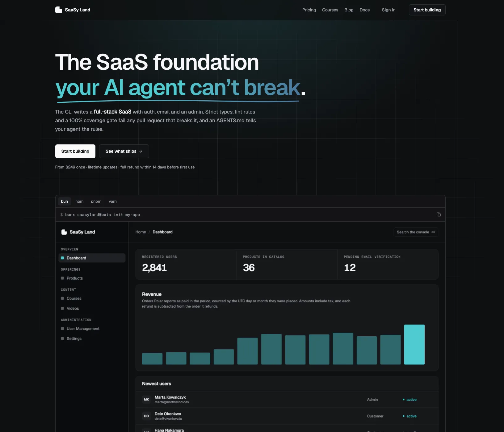
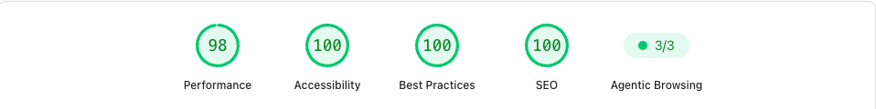

# SaaSy Land

Source code for the SaaSy Land website, customer workspace, and admin console. The application combines a multilingual marketing site, documentation and blog, authentication, newsletter subscriptions, video streaming and courses, and Polar checkout and licence management in one TanStack Start application deployed to Cloudflare Workers.

This repository contains the website application. The SaaSy Land CLI and private generator templates are maintained separately and are not included here. See [licensing](#licensing) for the distinction between the website source and the commercial product.

[](.github/assets/landing-page.jpg)

The landing page in September 2026. [View the full page](.github/assets/landing-page.jpg).

## Contents

- [Features and implementation status](#features-and-implementation-status)
- [Technology](#technology)
- [Getting started](#getting-started)
- [Configuration and integrations](#configuration-and-integrations)
- [Project structure and conventions](#project-structure-and-conventions)
- [Commands and verification](#commands-and-verification)
- [Database and deployment](#database-and-deployment)
- [Localization and content](#localization-and-content)
- [Performance](#performance)
- [Landing page videos](#landing-page-videos)
- [Contributing](#contributing)
- [Licensing](#licensing)

## Features and implementation status

Every admin screen reads real data from D1 through permission-checked server functions. A screen whose data has no source yet is not built, and the `admin-data/no-literal-data` lint rule fails `bun run check` when admin code declares demo data.

| Area                     | Current implementation                                                                                                                                                                                                                                                                                                                                                                                                                                                                                                                                                                                                                                                                                                                                                                                                                                                                                                                                                                                                                                                                                                                                                                                                                                                                                                                                                                                                                                                                                                                                                                                                                                                                                                                                                                                                                                                                                                                                               |
| ------------------------ | -------------------------------------------------------------------------------------------------------------------------------------------------------------------------------------------------------------------------------------------------------------------------------------------------------------------------------------------------------------------------------------------------------------------------------------------------------------------------------------------------------------------------------------------------------------------------------------------------------------------------------------------------------------------------------------------------------------------------------------------------------------------------------------------------------------------------------------------------------------------------------------------------------------------------------------------------------------------------------------------------------------------------------------------------------------------------------------------------------------------------------------------------------------------------------------------------------------------------------------------------------------------------------------------------------------------------------------------------------------------------------------------------------------------------------------------------------------------------------------------------------------------------------------------------------------------------------------------------------------------------------------------------------------------------------------------------------------------------------------------------------------------------------------------------------------------------------------------------------------------------------------------------------------------------------------------------------------------- |
| Public website           | Landing page with real products built on SaaSy Land in place of testimonials, linked once their sites are live (`PRODUCT_CASES`), pricing presentation whose tier cards list what each tier includes today and what is arriving (`TIER_FEATURES`), localized legal pages, responsive layouts, theme support, and reduced-motion presentations. Public pages are prerendered during builds, and every count on the landing page, like every file path and command it cites, comes from the repository at build time ([`scripts/repository-facts.ts`](scripts/repository-facts.ts)).                                                                                                                                                                                                                                                                                                                                                                                                                                                                                                                                                                                                                                                                                                                                                                                                                                                                                                                                                                                                                                                                                                                                                                                                                                                                                                                                                                                   |
| Documentation and blog   | Localized MDX content, navigation, and documentation search through Fumadocs, whose own controls are translated in every language like the rest of the site. On wider screens the docs sit in a frame wider than the rest of the site, with the reading column kept to a comfortable measure between the sidebar and the table of contents, and the site header and footer widen with that frame so the sidebar and the table of contents line up with the header; the header keeps its bottom line on every page and its place across the rest of the site; on a phone the docs keep the site header and one docs bar, and every docs page ends with the site footer. Every build turns the docs and the blog into static indexes per language, and the search into a static index the browser searches, so moving through the docs or the blog and searching the docs never reach the Worker, which holds no docs or blog content; a navigation that does take longer shows the skeleton of its page, beside the docs sidebar when it moves between docs pages. The site header loads its pages, the docs among them, once a page has loaded and the browser is idle, so a click on **Docs** usually waits for nothing. Published content is maintained in Git. A blog post shows the day it was first published and, once its facts or substance change, the day it was updated, and gives both to its structured data. A blog post can be shared by copying its link, through the system share sheet, or on X, LinkedIn, Bluesky, Hacker News, Reddit or by email, all without a third-party script, and it ends with its author and related posts. Every build writes `sitemap.xml` with `hreflang` alternates and each blog post's `lastmod`, an RSS feed of the blog in every language, and a social card for every prerendered page; see [Blog](content/docs/features/blog.en-US.mdx) and [Search and social previews](content/docs/features/seo.en-US.mdx). |
| Authentication           | Email/password registration that signs a new account in at once, so a buyer reaches the checkout without visiting the inbox, with the licence key, the Polar customer portal and paid lessons waiting for a confirmed address; GitHub and Google sign-in with a **Last used** badge; password recovery that keeps the address and the return path; TOTP with backup codes; and session management. Passwords have a minimum length and no composition rules, and new ones are checked against known data breaches (Have I Been Pwned). Better Auth's own endpoints enforce the same password, name, email and image rules as the forms, and verification and password-reset emails are limited per recipient.                                                                                                                                                                                                                                                                                                                                                                                                                                                                                                                                                                                                                                                                                                                                                                                                                                                                                                                                                                                                                                                                                                                                                                                                                                                        |
| Customer workspace       | Protected `/app` area, `/app/license` and `/app/settings`. Accounts without a licence see the landing page's tier cards with regional prices and the course lessons a purchase unlocks (counted from D1), and a tier button opens Polar's checkout straight away, in their language where Polar translates it, with their email filled in and a back button to the page they left; the line under the buttons says that Polar asks for the consent to immediate supply on the payment page, when the refund ends and, in a language Polar does not translate, that the payment page opens in English. A tier picked on the landing page carries through sign-up, whose page sums up the order: the tier, its price, the steps to the licence and the refund window. After payment the workspace waits for the licence to activate, celebrates (without motion for visitors who prefer less), and lists the steps to a first project: copy the key, activate it and generate a project, each with a copy button, ticked as the licence server records the activation and the first template download. Licence owners see their key and the CLI commands that activate it, generate a project, show and free a machine, each to copy, while the page fetches a key that is still being issued; until the address is confirmed, the key's place on the card and in the steps names the address the confirmation link went to, and the customer portal link waits too; a refunded or revoked licence says so without the key or commands and offers a new licence or support. The sidebar links to the courses with the lessons the customer has finished. In `/app/settings` a customer picks the time zone that every date in the workspace is shown in.                                                                                                                                                                                                               |
| Billing                  | Authenticated Polar checkout for the Core, Complete, and Agency tiers with regional (PPP) discounts, returning the buyer to the workspace in their language. The buyer consents to immediate supply and acknowledges losing the right of withdrawal once, by ticking Polar's required checkbox on the payment page, which the site leaves empty and Polar will not take a payment without; the buyer's language is stored on the order, and `polar:verify` checks that checkout localization is on. Webhook handling for purchases records the consent from the order's checkout field, emails the buyer a branded purchase confirmation in their language that repeats the consent (or, without it, the statutory right of withdrawal), the refund deadline and its conditions, and how to start: the licence page, the activate and init commands, the CLI guide and, for a tier with course access, the courses, full refunds (a partial refund keeps the licence), and licence-key benefits; a full refund marks the licence refunded and a revoked benefit marks it revoked. One licence per account: checkout is refused while a licence is active, and Polar's checkout endpoint is reachable only through that server-side check. Webhooks also copy each Polar order and subscription into D1 at Polar's latest version. A paid licence order whose customer matches no account emails the site's contact address an alert with the order, the buyer and a link to the order in Polar, and the admin dashboard lists every paid licence order that has no licence until it is recovered: link the Polar customer to the account and redeliver the order's webhook events, as the [Licences guide](content/docs/features/licences.en-US.mdx#orders-that-match-no-account) describes. Requires configured provider products and credentials.                                                                                                                  |
| CLI licence API          | The API that the `saasyland` CLI calls under `/api/cli/v1` to read a licence, to activate, check and release machines and to download the template bundle of a release. It is built on the `@saasyland/stack/api` contract, which the CLI imports too: the key is checked against D1, machines are Polar activations identified by an HMAC of the machine ID, activating again from the same machine reuses its slot, bundles come from a private R2 bucket through short-lived signed URLs, requests are rate-limited per IP address and per licence key, and the licence records its first activation and its first template download, so a refund request can be checked against what the CLI received. See the [CLI licence API guide](content/docs/features/cli-licence-api.en-US.mdx).                                                                                                                                                                                                                                                                                                                                                                                                                                                                                                                                                                                                                                                                                                                                                                                                                                                                                                                                                                                                                                                                                                                                                                         |
| Newsletter               | Double opt-in subscription with localized email delivery, limited per recipient. The confirmation and unsubscribe links open a page that acts only when the visitor presses its button. Server functions read and change a signed-in user's subscription, but no workspace screen uses them yet.                                                                                                                                                                                                                                                                                                                                                                                                                                                                                                                                                                                                                                                                                                                                                                                                                                                                                                                                                                                                                                                                                                                                                                                                                                                                                                                                                                                                                                                                                                                                                                                                                                                                     |
| Admin dashboard          | Counters for registered users, products, pending email verifications, learners, videos and newsletter subscribers; revenue per currency from the D1 copies of Polar's orders, refunds subtracted, and new users, each over the last 7 days, 30 days or 12 months in UTC; progress per course; the paid licence orders that have no licence; and the newest users. Every figure is read from D1 behind an admin permission, and an empty database shows empty states, never sample figures. See the [Admin dashboard guide](content/docs/features/admin-dashboard.en-US.mdx).                                                                                                                                                                                                                                                                                                                                                                                                                                                                                                                                                                                                                                                                                                                                                                                                                                                                                                                                                                                                                                                                                                                                                                                                                                                                                                                                                                                         |
| Admin users and security | Database-backed user listing and a profile page per user: adding a user, renaming, role changes, password reset, ban/unban with confirmation, deletion, impersonation with a banner to stop it, and revoking a user's sessions. The profile also shows the user's licence: tier, status, purchase time, consent to immediate delivery, first activation, first template download, and whether a refund is still possible. The settings security tab connects password changes, TOTP, and session revocation, and the general tab saves the admin's own time zone.                                                                                                                                                                                                                                                                                                                                                                                                                                                                                                                                                                                                                                                                                                                                                                                                                                                                                                                                                                                                                                                                                                                                                                                                                                                                                                                                                                                                    |
| Products and categories  | D1 schemas, permission-checked CRUD use cases, and read-only, database-backed lists; no admin screen creates or edits products yet.                                                                                                                                                                                                                                                                                                                                                                                                                                                                                                                                                                                                                                                                                                                                                                                                                                                                                                                                                                                                                                                                                                                                                                                                                                                                                                                                                                                                                                                                                                                                                                                                                                                                                                                                                                                                                                  |
| Courses                  | A public catalogue at `/courses` with course and lesson pages backed by D1 (`course`, `chapter`, `lesson`, `lesson_attachment`, and `lesson_progress`). Each lesson is a free preview, free with an account, or paid (an active Complete or Agency licence); the server functions enforce access, and admins can watch every lesson. Courses carry a level, an icon, outcomes and prerequisites; chapters a summary; lessons a description, key moments and materials (files in R2 and links), whose downloads are signed only for viewers who may open the lesson. A lesson without a video or on a placeholder video is listed as being recorded and does not play until a real recording replaces it; a published course whose lessons are all being recorded says so and offers no start link. The player resumes where the viewer stopped and saves progress. The admin at `/admin/courses` is the single place to edit all of it, in every locale, with a lesson editor for the text, key moments, video and materials. It exports courses to a JSON file and imports one after a dry run that lists what will change, matching courses and lessons by slug, so a second import of the same file changes nothing; `content/courses/saasy-land-courses.json` is the site's curriculum in every locale, ready to import. The catalogue leads with each course's cover; the course page shows the curriculum as an accordion beside a sticky panel with the course's state, its call to action and what it includes; the lesson page puts the player first with the course contents beside it, key moments that seek, a transcript from the captions and the materials. The landing page lists the published courses from D1 at view time, each with its first lessons open, locked or being recorded, and plays a tour of the course pages. See the [Courses guide](content/docs/features/courses.en-US.mdx).                                                    |
| Videos                   | Recordings are encoded on your machine to adaptive HLS with FFmpeg (`bun run video:publish:<environment>`), stored in a private R2 bucket, and streamed through signed, expiring `/media/` links with the Workers cache and range requests. `/admin/videos` lists, previews, and deletes them and marks a video as the placeholder for lessons being recorded, and course lessons play them. See the [Videos guide](content/docs/features/videos.en-US.mdx).                                                                                                                                                                                                                                                                                                                                                                                                                                                                                                                                                                                                                                                                                                                                                                                                                                                                                                                                                                                                                                                                                                                                                                                                                                                                                                                                                                                                                                                                                                         |
| Affiliates               | Referral links tracked by Affonso, loaded only on visits that carry a referral parameter; checkout passes the referral to Polar as order metadata, so commissions follow Polar's own order and refund records. `/affiliates` publishes the terms. Until `AFFILIATE_PROGRAM` in `src/data/affiliates.ts` opens the programme, no visit loads Affonso's script and the page asks partners to write in instead of linking the partner portal Affonso hosts; once it is open, tracking also needs the `AFFONSO_PROGRAM_ID` variable, which the production Worker sets. See the [Affiliate programme guide](content/docs/features/affiliates.en-US.mdx).                                                                                                                                                                                                                                                                                                                                                                                                                                                                                                                                                                                                                                                                                                                                                                                                                                                                                                                                                                                                                                                                                                                                                                                                                                                                                                                  |

The admin has no screens for pricing models, payments, blog posts, the landing page, invitations or roles yet: prices are set in code and in Polar, and posts in Git. The built-in application roles are `admin` and `customer`; new accounts receive `customer`.

## Technology

| Responsibility                   | Implementation                                                                                                                                                                                                                                                                                                                                               |
| -------------------------------- | ------------------------------------------------------------------------------------------------------------------------------------------------------------------------------------------------------------------------------------------------------------------------------------------------------------------------------------------------------------ |
| Application and routing          | React 19, TypeScript, TanStack Start and Router                                                                                                                                                                                                                                                                                                              |
| Toolchain                        | Bun, Vite+, formatting, linting, and type checking configured in `vite.config.ts`                                                                                                                                                                                                                                                                            |
| Hosting and storage              | Cloudflare Workers, D1 (SQLite), KV, R2, and static assets                                                                                                                                                                                                                                                                                                   |
| Database access                  | Drizzle ORM and checked-in SQLite migrations                                                                                                                                                                                                                                                                                                                 |
| Authentication and authorization | Better Auth with module-level permissions and server-function middleware                                                                                                                                                                                                                                                                                     |
| Data and forms                   | TanStack Query, Form, and Table; Zod validation                                                                                                                                                                                                                                                                                                              |
| CLI contract                     | `@saasyland/stack`: the CLI's questions, rules and flags, which the landing page's configurator asks, the UI library first, disabling with an hourglass each option the templates do not generate yet; `/cli`: its template support, exit codes, variables and credentials store; `/api`: the routes, schemas, errors and rate limits of the CLI licence API |
| UI                               | Tailwind CSS 4, shadcn-styled components with React Aria and Base UI, Motion, and locally served fonts                                                                                                                                                                                                                                                       |
| Localization and content         | `use-intl`, ICU messages, Fumadocs, and MDX                                                                                                                                                                                                                                                                                                                  |
| External services                | Resend for email; Polar for checkout, billing, and licence keys; Affonso for affiliate referrals                                                                                                                                                                                                                                                             |
| Video                            | FFmpeg encoding to HLS (CMAF) on the publisher's machine; Video.js 10 playback                                                                                                                                                                                                                                                                               |
| Verification                     | Vite+/Vitest, Testing Library, jsdom, and Playwright with axe-core accessibility scans                                                                                                                                                                                                                                                                       |

[`package.json`](package.json) and [`bun.lock`](bun.lock) define the application toolchain. The separate [Remotion project](remotion/README.md) uses its own npm lockfile. Check them for security advisories with `bun audit` at the root and `npm audit` inside `remotion/`; GitHub reads the npm lockfile but not `bun.lock`, so Dependabot alerts miss the application's transitive packages. Each `minimatch` entry under `overrides` is a security fix that waits for a parent release, and the [dependency conventions](content/docs/conventions/dependencies.en-US.mdx) name the upstream change that will let it go.

## Getting started

### Prerequisites

- **Bun 1.4.4**, matching `packageManager`; CI reads the version from it.
- **Node.js 26.13.1 or newer**, the version in [`.nvmrc`](.nvmrc): `nvm use` and CI read it, and `engines` in `package.json` requires it. 26.13.1 is the November 2026 security release of the Node 26 LTS line. Node is also needed by the SQLite test harness.
- A Cloudflare account and provider credentials for development against real services. The isolated preview and automated tests below do not require those accounts.

From the repository root:

```sh
bun install --frozen-lockfile
```

The install lifecycle configures Vite+ and generates the class-name tables and Fumadocs content. If you install with `--ignore-scripts`, run `bun run typegen` afterward to generate Worker declarations, class-name tables, and content types.

### Run an isolated local preview

Use the committed test environment to explore the application with local D1/KV/R2 storage, test accounts, a sample course at `/courses`, and intercepted provider requests:

```sh
bun run db:reset:test
bun run build:test
bun run start:test
```

Open <http://127.0.0.1:3000>. Sign in with any account below; each uses the password `WorkerTestPassword123!` from [`e2e/data/accounts.ts`](e2e/data/accounts.ts), and the licensed accounts and their licences come from [`e2e/data/licenses.ts`](e2e/data/licenses.ts).

| Role                             | Email                   | Workspace |
| -------------------------------- | ----------------------- | --------- |
| Admin                            | `admin@example.test`    | `/admin`  |
| Customer                         | `customer@example.test` | `/app`    |
| Customer with a Core licence     | `licensed@example.test` | `/app`    |
| Customer with a Complete licence | `learner@example.test`  | `/app`    |

This serves a built test application; rebuild it to see source changes. It uses dummy values from [`.env.test`](.env.test), the `test` environment in [`wrangler.jsonc`](wrangler.jsonc), and isolated state under `.wrangler/test`. Provider interception is intended for local verification, not for validating real OAuth, email delivery, or payments. Keep this test configuration local.

### Develop with Cloudflare and provider integrations

The development server supports hot reload at <http://localhost:3000>. Its `DB`, `CACHE`, `MEDIA`, and `BUNDLES` bindings are **local**, under `.wrangler/state`: development never reads or writes the preview or production data, and it needs no Cloudflare login. Local, preview, and production each have their own D1 database.

1. Copy the environment template and generate a secret:

   ```sh
   cp .env.example .env.development
   openssl rand -base64 48
   ```

2. Set the generated value as `AUTH_SECRET` in `.env.development`, then fill in the [integration settings](#configuration-and-integrations). Use `POLAR_SERVER=sandbox` for development. Optionally set `LOCAL_ADMIN_PASSWORD`, the password of the local admin; without it the seed uses a default that it prints and the [Database guide](content/docs/tooling/database.en-US.mdx#the-local-seed) lists.
3. Create, migrate, and seed the local database, then start the server:

   ```sh
   bun run db:reset:local
   bun run db:seed:local
   bun run dev
   ```

4. Sign in as `hello@saasyland.com` and open `/admin/courses`. `bun run db:studio:local` opens the same data in Drizzle Studio.

The seed creates that admin, imports the course curriculum from `content/courses/saasy-land-courses.json` with the same code as the admin's **Import**, and adds the licences, the order without a licence, and the CLI template bundle of the test seed. Run it again at any time; it changes only what differs.

Email/password signup requires a functioning Resend configuration: a new account is signed in at once, but its licence key and paid lessons wait for the confirmation link, and signing in again requires a confirmed address. GitHub/Google sign-in and checkout require their respective provider configuration. Use the isolated preview when you only need to inspect the UI without those services.

On preview and production, the first admin is created with `bun run admin:grant:preview <email>` or `bun run admin:grant:production <email>`; see [The first admin](#the-first-admin).

## Configuration and integrations

### Environment files

Use `.env.development`, `.env.preview`, and `.env.production` for their corresponding environments. These files are ignored by Git; [`.env.example`](.env.example) lists the configuration keys. `.env.test` contains committed dummy values for isolated tests.

Server integrations read secrets through `env` from `cloudflare:workers`. Do not give private credentials a `VITE_` prefix, which makes values available to browser code. Deployment scripts upload only the keys that `secrets.required` in [`wrangler.jsonc`](wrangler.jsonc) declares, read from the matching environment file.

| Variables                                                                       | Purpose                                                                                                                                                                                                                                                                                  |
| ------------------------------------------------------------------------------- | ---------------------------------------------------------------------------------------------------------------------------------------------------------------------------------------------------------------------------------------------------------------------------------------- |
| `AUTH_SECRET`                                                                   | Long random secret used by Better Auth. Generate a separate value for each deployment environment.                                                                                                                                                                                       |
| `AUTH_GITHUB_CLIENT_ID`, `AUTH_GITHUB_CLIENT_SECRET`                            | GitHub OAuth application credentials.                                                                                                                                                                                                                                                    |
| `AUTH_GOOGLE_CLIENT_ID`, `AUTH_GOOGLE_CLIENT_SECRET`                            | Google OAuth application credentials.                                                                                                                                                                                                                                                    |
| `RESEND_API_KEY`, `RESEND_EMAIL_FROM`                                           | Email API credentials and the sender accepted by your Resend account.                                                                                                                                                                                                                    |
| `POLAR_SERVER`                                                                  | Polar environment: `sandbox` for development and preview, `production` for live billing. `polar:verify` refuses any other pairing.                                                                                                                                                       |
| `POLAR_ACCESS_TOKEN`, `POLAR_ORGANIZATION_ID`                                   | Polar API access and the organization used for discounts and licence operations.                                                                                                                                                                                                         |
| `POLAR_WEBHOOK_SECRET`                                                          | Secret used to verify Polar webhook deliveries.                                                                                                                                                                                                                                          |
| `POLAR_PRODUCT_ID_CORE`, `POLAR_PRODUCT_ID_COMPLETE`, `POLAR_PRODUCT_ID_AGENCY` | Product IDs mapped to the three checkout tiers. Use IDs from the selected Polar environment.                                                                                                                                                                                             |
| `CLOUDFLARE_ACCOUNT_ID`, `CLOUDFLARE_DATABASE_ID`, `CLOUDFLARE_ACCESS_TOKEN`    | Credentials for Drizzle Studio and introspection over the D1 HTTP API. Application queries use the `DB` binding instead.                                                                                                                                                                 |
| `AFFONSO_PROGRAM_ID`                                                            | Optional Worker variable (`vars` in `wrangler.jsonc`), set only for the environment that takes real payments. The public Affonso program ID that affiliate referral tracking needs; tracking runs only while `AFFILIATE_PROGRAM` in `src/data/affiliates.ts` says the programme is open. |

The development, preview, and production environments declare **every key above except `AFFONSO_PROGRAM_ID`** in `secrets.required`, including the Cloudflare credentials used by Drizzle tooling. `AFFONSO_PROGRAM_ID` is public, so it is a plain Worker variable under `vars`, not a secret; `production` sets SaaSy Land's programme ID and `test` a dummy ID for the browser tests. Supply the required secrets for the selected environment; see [`wrangler.jsonc`](wrangler.jsonc) for the authoritative list.

### Domains and branding

The public URL is configured in source: [`src/presentation/branding/index.ts`](src/presentation/branding/index.ts) defines `APP_DOMAIN` and derives `APP_URL` as `https://${APP_DOMAIN}`, together with the contact addresses, the GitHub organisation and repository URLs and the Instagram profile, which the footer links and the home page's structured data lists. **`VITE_APP_URL` is not read by the application.**

When adapting the application to your own domain, update these locations together:

| Location                                                                   | What to configure                                                                                                                                                                                                                                                                                                                                                                                                                 |
| -------------------------------------------------------------------------- | --------------------------------------------------------------------------------------------------------------------------------------------------------------------------------------------------------------------------------------------------------------------------------------------------------------------------------------------------------------------------------------------------------------------------------- |
| [`src/presentation/branding/index.ts`](src/presentation/branding/index.ts) | Application name, canonical domain, preview host (`APP_PREVIEW_DOMAIN`), contact addresses, GitHub identity and Instagram profile (`APP_INSTAGRAM_URL`).                                                                                                                                                                                                                                                                          |
| [`src/modules/_core/constants/api.ts`](src/modules/_core/constants/api.ts) | `DEPLOYED_HOSTS`, the preview and production hosts read from `APP_PREVIEW_DOMAIN` and `APP_DOMAIN`, and the one place the code names them by environment.                                                                                                                                                                                                                                                                         |
| [`wrangler.jsonc`](wrangler.jsonc)                                         | Worker names, custom-domain routes, D1 databases, KV namespaces, and R2 buckets for each environment.                                                                                                                                                                                                                                                                                                                             |
| [`src/data/marketing.ts`](src/data/marketing.ts)                           | Tier prices (`TIER_PRICES`), tier features available now or arriving (`TIER_FEATURES`), the consulting rate (`CONSULTING_HOURLY_RATE`), the real products on the landing page (`PRODUCT_CASES`), and the course platforms' URLs, build counts and the status of Complete's access to each (`REACTPROJECTS_FACTS`, `ANGULARPROJECTS_FACTS`, `REACTPROJECTS_ACCESS`, `ANGULARPROJECTS_ACCESS`); `polar:verify` checks Polar prices. |
| [`src/presentation/styles/`](src/presentation/styles)                      | Theme, typography, fonts, and shared style definitions.                                                                                                                                                                                                                                                                                                                                                                           |

The branding names the preview host, `APP_PREVIEW_DOMAIN` (`preview.<APP_DOMAIN>`), and the production host, `APP_DOMAIN`, and `DEPLOYED_HOSTS` maps the `preview` and `production` environments to them. `appHostsForMode` reads it for the hosts Better Auth and newsletter links accept in each mode, and the deployment scripts' live check requests it, so change `APP_PREVIEW_DOMAIN` when your preview host has another name. The custom-domain `routes` in `wrangler.jsonc` and the environment URLs in [`deploy-reusable.yml`](.github/workflows/deploy-reusable.yml) name the same hosts and must match; [`src/__test__/wrangler.test.ts`](src/__test__/wrangler.test.ts) fails when the routes differ. Changing an environment file alone does not change the canonical URL. Rebuild after changing branding or deployment configuration.

### Provider setup

- Configure GitHub and Google callback URLs at `https://<your-host>/api/auth/callback/github` and `https://<your-host>/api/auth/callback/google`. Use the appropriate development or deployed origin.
- Configure Resend credentials and the sender address before testing verification, password recovery, newsletter delivery, or purchase confirmations. Templates live in [`src/presentation/emails/`](src/presentation/emails).
- Set up Polar as the [Polar setup guide](content/docs/getting-started/polar-setup.en-US.mdx) describes: separate sandbox and production organisations, an organisation token with the listed scopes, one one-time product per tier priced from `TIER_PRICES` with one licence-key benefit limited by `LICENSE_ACTIVATION_LIMITS` ([`license.constants.ts`](src/modules/license/license.constants.ts)), never expiring and without a usage limit, the required consent checkbox `withdrawal_consent` on every product with the label in `WITHDRAWAL_CONSENT_FIELD` ([`src/lib/polar.ts`](src/lib/polar.ts)), and an automatic percentage discount without a code for each band in the [pricing rules](src/modules/license/license.pricing.ts).
- Create one Polar webhook per deployed host at `https://<your-host>/api/auth/polar/webhooks`, in the raw format, signed with `POLAR_WEBHOOK_SECRET` and subscribed to exactly `POLAR_EVENTS` from [`src/data/polar-events.ts`](src/data/polar-events.ts), the events every area handles; today these are the licence area's `LICENSE_WEBHOOK_EVENTS` and the order and subscription events that the billing area copies into D1 ([`billing.polar-events.ts`](src/data/billing.polar-events.ts)). The licence [handlers](src/modules/license/license.webhooks.ts) process paid orders, full refunds (a partial refund keeps the licence), and licence-benefit creation and revocation.
- Run `bun run polar:verify:<environment>` after every change in Polar. It reads the Polar keys from `.env.<environment>`, sends only GET requests, and fails with one line per difference between Polar and the code. Checkout and the check share one [regional discount rule](src/integrations/polar/polar.discounts.ts).

The website associates purchases and issued keys with authenticated customers, exposes activation management and serves the [CLI licence API](content/docs/features/cli-licence-api.en-US.mdx) through which the CLI activates machines and downloads the templates of its release. The CLI itself and the templates it generates are maintained separately; customers activate their licence and generate their projects with it as the [CLI guide](content/docs/cli/index.en-US.mdx) describes, and its [release notes](content/docs/cli/releases.en-US.mdx) and the [roadmap](content/docs/project/roadmap.en-US.mdx) say what it does today and what is arriving.

## Project structure and conventions

```text
content/
  blog/                          Localized MDX posts
  changelog/                     One changelog entry per pull request and locale, dated from the Git history
  docs/                          Localized MDX documentation and navigation metadata
messages/{locale}/               JSON catalogues split into dotted namespaces
e2e/                             Playwright specs, the journey suite, and the seeded test accounts, video, and course
scripts/                         Content checks, build, deployment and release steps, seeding, video publishing, and tooling
remotion/                        Video authoring source and isolated npm toolchain
src/
  routes/                        TanStack file routes, loaders, guards, and HTTP handlers
  routes.ts                      Shared route constants
  router.tsx                     Per-request QueryClient and SSR integration
  server.ts                      Cloudflare Worker entry: the areas' Worker handlers, locale middleware, and security headers
  integrations/{vendor}/         Vendor configuration and adapters ({prefix}.{concern}.ts, e.g. auth.server.ts)
  modules/{table}/               One folder per database table: schema, zod, constants, types, use-cases/*.ts
  modules/_core/                 Shared error codes, catalogues, and helpers
  presentation/
    assets/motion/               Published landing-page videos and posters
    branding/                    Application identity and canonical URL
    components/shadcn/           UI primitives (React Aria; Base UI for the drawer)
    components/custom/           Shared components, plus app/, auth/, blog/, courses/, admin/{page}/, landing-page/
    emails/                      Email templates (markup and message namespace only)
    social-card.tsx              Social cards rendered at build time with Takumi
    styles/                      Theme, typography, and local font declarations
  providers/                     Application-wide React providers
  data/                          Data shared by several files, and what each area adds: routes, menus, skeletons, layout namespaces, Worker handlers, root components, the time zone, Vite plugins, deploy checks, live site checks, Better Auth plugins and emails, the customer overview, the Polar webhook events
  hooks/                         Shared React hooks
  lib/                           Shared utilities (cn, confetti, cookies, the deploy checks of secrets and OAuth client IDs, the deployed-site check, durations, hex hashes and tokens, rate limits, release tags and notes, route search params, select options, SEO tags, prerendered page heads, robots.txt rules, the sitemap, the blog feeds, GitHub stars, not-found errors)
  platform/testing/              Test Worker, mocks, RPC helpers, and render helpers
```

Routes coordinate loading and rendering. Business operations live in table modules and export native TanStack `createServerFn` functions with query or mutation options. Components consume those options; database and provider clients stay behind server boundaries.

A route file only composes its page: it defines the `<Name>Page` or `<Name>Layout` component, `const NAMESPACE` (page routes) or `const NAMESPACES` (layout routes), a loader that runs metadata, message and data loading in one `Promise.all`, and `head: pageHead(ROUTES.X)`. Widgets, dialogs, forms, and table columns live in their own files under `presentation/components/custom`, one per file, and read their own translations and data instead of receiving labels as props. Forms follow the shadcn TanStack Form pattern with the module's Zod schema, show a field's error only once the visitor leaves it or tries to submit (`isFieldInvalid`, `validateOnBlur` and `submitForm` in `src/integrations/tanstack-form/`), and keep the submit button enabled, moving focus to the first invalid field on a failed submit. Tables use the generic `DataTable` with columns defined in an `{entity}-columns.tsx` file. Email templates contain markup only; the use case that sends an email loads its messages and renders the template.

Validate inputs at the server boundary and authorize protected functions themselves, in addition to page guards. Query and mutation keys are readonly tuples owned by the feature's `*.constants.ts`; include inputs that change the result in the query key. Domain values such as statuses, kinds, tiers, roles and provider IDs are named once in a constant object (`PRODUCT_STATUS`, `LICENSE_TIER`, `AUTH_PROVIDER`) in the owning module's or integration's `*.constants.ts`, and code, tests and e2e data import it instead of repeating the string. Reuse exported options for cache access, and invalidate only the data a mutation changes. Application documentation lives in [`content/docs/`](content/docs), including the [architecture guides](content/docs/architecture) and the [conventions](content/docs/conventions/index.en-US.mdx), the coding standard every change follows. Coding agents start from [`AGENTS.md`](AGENTS.md).

Authentication entry points are in [`src/integrations/better-auth/`](src/integrations/better-auth):

| File                 | Responsibility                                                                                                                                                                    |
| -------------------- | --------------------------------------------------------------------------------------------------------------------------------------------------------------------------------- |
| `auth.server.ts`     | Better Auth, providers, plugins (with those the areas add in `src/data/<area>.auth-plugins.ts`), the emails the areas send (`src/data/<area>.auth-emails.ts`), and allowed hosts. |
| `auth.access.ts`     | Roles, permissions, and permission checks, built from each area's `src/data/<area>.access.ts`.                                                                                    |
| `auth.roles.ts`      | Role codes and the default role.                                                                                                                                                  |
| `auth.hooks.ts`      | Input policy run before Better Auth's own endpoints: the password, name, email and image rules.                                                                                   |
| `auth.routes.ts`     | Sign-in/admin guards, the return path after sign-in, and role-based redirects.                                                                                                    |
| `auth.middleware.ts` | Server-function authorization, error handling, rate limiting, and the client address Better Auth's limiter uses.                                                                  |
| `auth.session.ts`    | Request-scoped session lookup and UI query options.                                                                                                                               |

Authorization shares a fresh session lookup within one HTTP request; a new request checks session storage again. Route navigation rechecks sessions. Sign-in and sign-out remove the previous user's cached data, and so do route guards when the authenticated user changes; public queries (`meta: { public: true }`), such as translations, stay cached. Rate limiting uses atomic D1 operations, writes nothing for a request it refuses and rejects requests when its storage is unavailable. Expired counters are removed in a bounded batch once per counted request; there is no scheduled cleanup Worker. Verification, password-reset and newsletter confirmation emails are also limited to three of each kind per hour for each address, keyed by a SHA-256 of the address; an email over the limit is skipped without an error, and the resend and reset forms read the allowance first and tell the visitor when they can try again instead of claiming a send.

Email-verification links enter `/auth/verify-email` and redirect to Better Auth's native endpoint; an expired or used link comes back to a page that names its address and leads with a new link. Newsletter confirmation and unsubscribe links open a page that only loads its messages; the action runs when the visitor presses the button, so link scanners cannot confirm or unsubscribe. Success replaces the token URL with a result notice; a failure shows an error and keeps the token for retry.

[`src/server.ts`](src/server.ts) sets baseline security headers on every Worker response: a Content Security Policy that sets `base-uri`, `frame-ancestors` and `object-src` to `'none'`, `Cross-Origin-Opener-Policy`, `Permissions-Policy`, `Referrer-Policy`, `X-Content-Type-Options`, `X-Frame-Options: DENY`, and HSTS on HTTPS responses. They are defined once, as `SECURITY_HEADERS` and `HTTPS_SECURITY_HEADERS` in [`src/modules/_core/constants/api.ts`](src/modules/_core/constants/api.ts), and replace any value already on the response. Static files that bypass the Worker get the same headers from the `/*` rule in [`public/_headers`](public/_headers), which a test keeps equal to those constants.

Every page also runs only the scripts it was served with, under a strict policy with `'strict-dynamic'`: every HTML response gets a nonce of its own in its header, which TanStack Start puts on the scripts of a page it renders and an `HTMLRewriter` puts on the scripts of a prerendered page, so Cloudflare can give it to the scripts it injects at the edge. Each spec of the browser suite fails when a page reports a violation.

## Commands and verification

Use `bun run test` to invoke the configured Vite+ test runner. Running `bun test` directly does not use this test setup.

| Command                                                                     | Purpose                                                                                                                         |
| --------------------------------------------------------------------------- | ------------------------------------------------------------------------------------------------------------------------------- |
| `bun run dev`                                                               | Generate content/class-name tables and start development with local bindings.                                                   |
| `bun run typegen`                                                           | Generate Worker declarations, class-name tables, and Fumadocs content/types.                                                    |
| `bun run check`                                                             | Generate class-name tables; check localization/content, the flow inventory, formatting, lint, and types.                        |
| `bun run check:flows`                                                       | Fail when a flow in `e2e/data/<area>.flows.ts` names a browser test that is gone or skipped, or does not say why it is missing. |
| `bun run check:fix`                                                         | Run checks and apply supported formatting/lint fixes.                                                                           |
| `bun run check:i18n`                                                        | Validate message parity, scoped translation keys, unrendered keys, ICU formats, forms of address, and localized content.        |
| `bun run test`                                                              | Run node, integration, and component test projects.                                                                             |
| `bun run test:unit` / `bun run test:integration` / `bun run test:component` | Run one test project.                                                                                                           |
| `bun run test:watch` / `bun run test:changed`                               | Watch tests or run tests affected by changes.                                                                                   |
| `bun run test:coverage`                                                     | Run tests with the configured coverage gate and reports.                                                                        |
| `bun run test:e2e:install`                                                  | Install Chromium/WebKit and their Playwright dependencies.                                                                      |
| `bun run test:e2e`                                                          | Run the browser suite in Chromium and WebKit.                                                                                   |
| `bun run test:e2e:pr`                                                       | Run the browser suite in Chromium, as pull request CI does.                                                                     |
| `bun run test:e2e:smoke`                                                    | Run the Chromium smoke suite.                                                                                                   |
| `bun run test:all`                                                          | Run the Vite+ tests followed by Chromium smoke tests.                                                                           |
| `bun run test:journey`                                                      | Buy each tier on preview with the Polar sandbox and use the published CLI with each licence.                                    |
| `bun run build` / `bun run build:preview`                                   | Build the preview Worker, prerender public pages, and verify/optimize output.                                                   |
| `bun run build:production`                                                  | Build and verify the production application.                                                                                    |
| `bun run build:test` / `bun run start:test`                                 | Build or serve the isolated test application.                                                                                   |
| `bun run start`                                                             | Serve the most recently built application at `127.0.0.1:3000`.                                                                  |
| `bun run video:publish:preview` / `bun run video:publish:production`        | Encode a recording with FFmpeg, then upload and register it with your `wrangler login`.                                         |

Run the commands from the root [package scripts](package.json); the Remotion commands run inside `remotion/`.

### Test architecture and coverage

Unit and integration tests run in Node; component tests run in jsdom. Tests are colocated in `src/**/__test__/`. The test RPC helper exercises TanStack validation and middleware, and the D1 adapter applies the checked-in SQLite migrations. External provider operations are mocked. See the [testing guide](src/platform/testing/README.md) for fixtures and ownership conventions.

Coverage includes TypeScript application code under `src`, including routes, custom components, providers, and integrations. Exclusions cover tests/fixtures, test infrastructure, generated router/declaration files, and shadcn primitives. The configured gate requires **100% statements, branches, functions, and lines** for the included code. This is a test requirement, not a claim that every product workflow is complete. Read measured results in `coverage/index.html` and `coverage/coverage-summary.json`; Playwright does not contribute to this report.

Flow coverage is reported on its own. Each area lists its user and admin flows in `e2e/data/<area>.flows.ts`, joined by [`e2e/data/flows.entries.ts`](e2e/data/flows.entries.ts): a flow is covered when it names the Playwright test that performs it end to end and asserts its outcome, missing when the feature exists without such a test, and to build when the feature does not exist yet; the last two say why. `bun run check` runs [`scripts/check-flows.ts`](scripts/check-flows.ts), which lists the browser suite and fails when a flow names a test that is gone or skipped, so renaming a test without its flow fails CI. The [Test coverage](content/docs/tooling/test-coverage.en-US.mdx) docs page prints how many flows are covered, every flow with its test, and the gaps.

### Browser tests and CI

```sh
bun run test:e2e:install
bun run test:e2e
```

Locally, Playwright recreates the test database with `db:reset:test`, builds the test application, and starts its preview server unless an existing server already answers at the configured URL. Stop other servers on port 3000 before running the suite so it uses the intended test application. `PLAYWRIGHT_BASE_URL` overrides the default `http://127.0.0.1:3000`.

`bun run test:journey` runs the journey suite in [`e2e/journey/`](e2e/journey/) by hand against the preview deployment instead: it signs up through Resend's test inbox, buys each tier on the Polar sandbox checkout with Stripe's test card, and activates, fills, frees and deactivates machines with the published CLI until a refund ends the licence. It reads the Polar sandbox token and product IDs and a full-access Resend key from the environment or `.env.preview`; see [Journey suite](content/docs/tooling/playwright.en-US.mdx#journey-suite).

[`e2e/specs/accessibility.spec.ts`](e2e/specs/accessibility.spec.ts) runs axe-core with the WCAG 2.0, 2.1 and 2.2 A and AA rules and axe's best practices on the public pages, the course pages, the docs home, every Conventions page and one page from each other docs section, a blog post, and both workspaces in the light and dark themes, and fails on any violation.

`build:test` selects `env.test` in the root `wrangler.jsonc` using `CLOUDFLARE_ENV=test`. It uses the test Worker entry, local bindings, `.env.test`, and `.wrangler/test`; no separate test Wrangler file or `E2E=true` flag is needed. In CI, `db:reset:test` and `build:test` run explicitly before Playwright starts the server.

- [Main CI](.github/workflows/ci.yml) runs checks, coverage, and Chromium E2E on pull requests and pushes to `main`. Successful eligible runs then deploy to Cloudflare, and each successful production deploy is tagged and released on GitHub.
- [Full E2E](.github/workflows/e2e-full.yml) adds WebKit on pushes to `main` and runs Chromium and WebKit weekly and on manual dispatch.
- [Video CI](.github/workflows/remotion.yml) separately checks and bundles the Remotion project when `remotion/` or a website file it imports changes, directly or through other website files; [`src/__test__/workflows.test.ts`](src/__test__/workflows.test.ts) fails when its trigger paths miss such a file or name a path that none of them matches.

The [deployment workflow](.github/workflows/deploy-reusable.yml) records actual deployment results in GitHub's `Preview` and `Production` environments. Configure its credentials as described below before enabling deployments.

## Database and deployment

### Provision Cloudflare resources

For a new Cloudflare account, create a preview database, KV namespace, and R2 buckets:

```sh
bunx wrangler login
bunx wrangler d1 create saasyland_com_preview
bunx wrangler kv namespace create CACHE --env preview
bunx wrangler r2 bucket create saasyland-preview
bunx wrangler r2 bucket create saasyland-bundles-preview
```

Replace `database_id`, `database_name`, the KV namespace `id`, and the `bucket_name` of `MEDIA` and `BUNDLES` under `preview` in `wrangler.jsonc`. Keep the binding names `DB`, `CACHE`, `MEDIA`, and `BUNDLES`, and preserve `migrations_dir`. The `development` environment binds local resources and needs no change. Update Worker names and custom-domain routes for your account.

Create separate production resources with `saasyland_com_production`, `bunx wrangler kv namespace create CACHE --env production`, `bunx wrangler r2 bucket create saasyland`, and `bunx wrangler r2 bucket create saasyland-bundles`, then update the `production` bindings. The `BUNDLES` buckets hold the CLI's template bundles, each with the SHA-256 of its content as its `sha256` custom metadata, which the licence API answers with instead of reading the archive; the CLI repository's release uploads them to both; see [Publishing bundles](content/docs/features/cli-licence-api.en-US.mdx#publishing-bundles). The deployment guard rejects missing bindings, placeholder IDs, and a production environment that shares its database, namespace, or bucket with preview; it does not verify that the existing IDs belong to your account or that the R2 buckets exist, and a deploy fails while a bound bucket is missing.

### Migrations

Module schemas are collected by [`drizzle.schemas.ts`](src/integrations/drizzle-orm/drizzle.schemas.ts), and every table with `createdAt` and `updatedAt` spreads them from `timestamps()` in [`drizzle.columns.ts`](src/integrations/drizzle-orm/drizzle.columns.ts). Generate migrations with:

```sh
bun run db:generate
```

Review and commit SQL files under `src/integrations/drizzle-orm/migrations/` with their schema changes. The deployment scripts and CI apply the target's migrations before deploying; apply them to the local databases yourself.

| Command                         | Database affected                                                                        |
| ------------------------------- | ---------------------------------------------------------------------------------------- |
| `bun run db:migrate:local`      | Local development database under `.wrangler/state`, used by `bun run dev`.               |
| `bun run db:reset:local`        | Deletes the local development database, then migrates it.                                |
| `bun run db:seed:local`         | Seeds the local development database: the admin, the curriculum, licences, and an order. |
| `bun run db:migrate:test`       | Local test database in `.wrangler/test`.                                                 |
| `bun run db:reset:test`         | Deletes `.wrangler/test`, then migrates and seeds the local test database.               |
| `bun run db:migrate:preview`    | Remote preview database.                                                                 |
| `bun run db:migrate:production` | Remote production database.                                                              |

`db:migrations:local`, `db:migrations:preview`, and `db:migrations:production` list the migrations each database has not applied yet, without changing anything. `db:studio:local` opens Drizzle Studio on the local SQLite file that the dev server uses, which `scripts/studio-local.ts` locates under `.wrangler/state/v3/d1/`. `db:studio:preview` and `db:studio:production` open it on a remote database using the corresponding environment file, and the matching `db:introspect:*` scripts introspect D1 through its HTTP API; set the three `CLOUDFLARE_*` credentials to the target account/database for these tools. The full guide is [Database](content/docs/tooling/database.en-US.mdx).

### Course data

Locally, `bun run db:seed:local` imports `content/courses/saasy-land-courses.json`. On preview and production an admin imports the same file: **Content → Courses**, **Import**, choose the file, **Check file**, then **Import**. Importing it twice changes nothing. No script writes course data to a remote database.

### The first admin

The application has no endpoint, seed, or variable that grants the `admin` role. On preview and production, create the first admin with:

```sh
bunx wrangler login
bun run admin:grant:production you@example.com
```

Sign up on the site with that address and verify it first. [`scripts/grant-admin.ts`](scripts/grant-admin.ts) reads the account with `wrangler d1 execute --remote`, prints it before and after, refuses an unknown, unverified, or banned account, and changes only that account's `role`. It is the only way to create the first admin, and it is safe: only someone who can write to that Cloudflare account's D1 database can run it, with their own `wrangler login`; the application enforces roles on the server (`requireAdmin` and `authorized(...)` on every admin server function); and later admins are granted in **Administration → User Management** with **Change role** by an existing admin.

### Automatic GitHub deployments

The CI workflow deploys only after formatting, lint, types, localization, coverage, and Chromium E2E pass:

| Event                                                                      | Cloudflare target               | GitHub environment | URL                             |
| -------------------------------------------------------------------------- | ------------------------------- | ------------------ | ------------------------------- |
| Pull request opened, reopened, or updated from a branch in this repository | `saasyland-preview` (`preview`) | `Preview`          | <https://preview.saasyland.com> |
| Push to `main`, including merging a pull request                           | `saasyland` (`production`)      | `Production`       | <https://saasyland.com>         |

Preview is a **shared environment**: each successful PR deployment replaces the previous preview, using the same preview D1 database, KV namespace, and R2 bucket. It does not create a separate Worker or database for each PR. Fork and Dependabot PRs run validation without privileged deployments; move a reviewed change to a trusted repository branch to preview it.

In [repository Settings → Environments](https://github.com/saasyland/saasyland.com/settings/environments), configure the existing `Preview` and `Production` environments with these secrets:

| Secret                  | Purpose                                                                                                                                                                          |
| ----------------------- | -------------------------------------------------------------------------------------------------------------------------------------------------------------------------------- |
| `CLOUDFLARE_API_TOKEN`  | Wrangler authentication with permission to deploy the Worker, manage its configured bindings/routes, and apply D1 migrations. Scope the token to the intended account and zones. |
| `CLOUDFLARE_ACCOUNT_ID` | Cloudflare account containing the selected Worker, D1 database, KV namespace, and R2 bucket.                                                                                     |

These are deployment credentials. `CLOUDFLARE_API_TOKEN` is separate from the `CLOUDFLARE_ACCESS_TOKEN` used by Drizzle Studio. Repository secrets with the same names can be used as a fallback; environment-specific secrets allow different credentials for preview and production. Follow [Cloudflare's GitHub Actions authentication guide](https://developers.cloudflare.com/workers/ci-cd/external-cicd/github-actions/) when creating the token.

The existing Workers must already have all runtime secrets required by `wrangler.jsonc`. CI builds with committed dummy credentials from `.env.test` because prerendering initializes provider clients, while still selecting the real preview/production configuration and Worker entry. It removes the generated local `.dev.vars` file before deployment. No real provider credentials are needed in GitHub, and no secrets file is uploaded: Wrangler inherits the selected Worker's existing secrets. A new Worker still needs the initial provisioning described in the manual deployment section.

Deployment jobs build and verify artifacts, apply the target D1 migrations, then deploy the tested revision. They do not run the live site check (`scripts/verify-deployment.ts`) that the manual deployment scripts run, because Cloudflare's bot protection answers 403 to requests from CI runners, nor any of the deploy checks the areas declare (`scripts/run-deploy-checks.ts`; today `auth:verify` and `polar:verify`), because CI has no `.env.<environment>` and GitHub holds only the Cloudflare deployment credentials. The URL each GitHub environment links to is typed in the workflow, and [`src/__test__/workflows.test.ts`](src/__test__/workflows.test.ts) fails when it differs from the environment's host in `DEPLOYED_HOSTS`. Workflow runs and deployments queue rather than cancel one another, with a separate deployment queue per environment. Schema changes must remain compatible with the currently running application because migrations run before the new Worker is deployed. WebKit's additional main-branch suite runs independently of the production deployment gate.

GitHub creates deployment records from the job's `environment` declaration and shows the job's real result. See [GitHub's deployment tracking documentation](https://docs.github.com/en/actions/how-tos/deploy/configure-and-manage-deployments/control-deployments).

After a production deploy succeeds, the `release` job tags the deployed commit `vYYYY.MM.DD` with the UTC date (later deploys that day get `.2`, `.3`, and so on) and publishes a GitHub Release whose notes are the [changelog entries](content/changelog) that reached `main` that day, each ending with its pull request's number. It is the only job with `contents: write`, and preview deploys are never tagged. The changelog dates each entry by the squash commit that brought its pull request to `main`, so the checkouts that build the site and the `release` job fetch every commit without its trees (`fetch-depth: 0` and `filter: tree:0`). In CI, the build fails while the changelog would list an entry as unreleased that is not the pull request's own, or any entry on `main`. [CI/CD](content/docs/tooling/ci-cd.en-US.mdx) explains how to roll back to a release.

Keep this workflow the only deployment owner: disable automatic deploy triggers in Cloudflare Workers Builds so a push does not deploy twice or bypass the CI gate. Worker source maps are not uploaded (`upload_source_maps: false` in `wrangler.jsonc`), because they pushed the upload past Cloudflare's size limit. Production environment branch rules can restrict deployment to `main`; preview rules must allow PR merge refs. Required environment reviewers, if configured, pause deployment until approval.

### Manual preview and production deployment

After provisioning resources and configuring domains and secrets:

```sh
cp .env.example .env.preview
# Fill in preview secrets and sandbox provider settings before continuing.
bun run deploy:preview
```

For production:

```sh
cp .env.example .env.production
# Fill in production secrets and live provider settings before continuing.
bun run deploy:production
```

Each deployment script verifies the bindings, writes the secrets that `wrangler.jsonc` declares for that environment from the environment file to `.wrangler/secrets.<environment>.json`, failing if any is empty or a placeholder such as `[UPDATE]` or `TODO`, runs the deploy checks the areas declare (`scripts/run-deploy-checks.ts`; today `auth:verify`, which checks that the GitHub and Google client IDs have their providers' formats, and `polar:verify`, which checks that the environment's Polar organisation matches the code), builds the selected environment, checks the generated artifacts, optimizes prerendered HTML, and writes the sitemap and social cards. It then applies the environment's D1 migrations, deploys `dist/server/wrangler.json` (the configuration the Cloudflare Vite plugin generates) with that secrets file, and finally checks the live site: it requests the home page, the course catalogue, `robots.txt`, `sitemap.xml`, the site social card, `/api` and `/api/auth/get-session`, and starts the GitHub and Google sign-in as the browser does, failing unless each provider's authorize URL is on that provider's host and carries a client ID in that provider's format and a callback to the same host. It retries each failing check twice. Builds alone do not apply remote migrations or deploy resources.

Public pages are prerendered to `dist/client`; protected, authentication, newsletter-action, course, and API routes are excluded from prerendering. After prerendering, [`scripts/deployed-worker.ts`](scripts/deployed-worker.ts) builds the Worker that is deployed again, without the rendered MDX of docs and blog pages and without the landing and legal page translations, which only prerendered pages use. The build verifier checks the Worker deployment configuration, localized home/legal pages and SEO links, that every docs page and published blog post was prerendered, fonts, client JavaScript, and selected route exclusions. [`scripts/generate-seo-files.ts`](scripts/generate-seo-files.ts) then reads the head of every prerendered page and writes `dist/client/sitemap.xml`, the blog's RSS feed in every language (`dist/client/blog/rss.xml` and its localized copies), the organisation's logo and one social card per page under `dist/client/images/og/`; the Worker serves them all from static assets. The application still requires a Worker for server-rendered routes, authentication, APIs, video delivery, and locale handling.

## Localization and content

The supported locales are `en-US`, `de-DE`, `es-ES`, `fr-FR`, `it-IT`, `ja-JP`, `pl-PL`, `pt-BR`, and `uk-UA`, defined in [`i18n.config.ts`](src/integrations/use-intl/i18n.config.ts).

English uses unprefixed paths. Other languages use the full locale, such as `/de-DE/docs` or `/pl-PL/blog`; short aliases redirect to canonical paths. Switching language opens the current path in the chosen language; the query string and fragment are not carried over. The locale always comes from the URL path, so server functions that need it receive it as input, because their `/_serverFn` URLs carry no locale prefix.

- Store UI messages in `messages/{locale}/`, using the same keys, ICU arguments, rich-text tags, file paths, and commands across locales and each language's plural categories.
- Store documentation and blog content as `slug.{locale}.mdx` under `content/docs` and `content/blog`, and each pull request's changelog entry as `{number}.{locale}.mdx` under `content/changelog`; localized navigation uses `meta.{locale}.json`.
- Translate frontmatter, visible component attributes, FAQ entries, and body text. Preserve slugs, inline code, MDX components and their untranslated props, code examples, table rows, and link destinations; `bun run check:i18n` compares them with English.
- Write internal links in content as the paths the site serves, such as `/docs/cli` or `/#pricing`: no locale, no trailing slash, `/index` or `.html`. MDX links add the page's locale with `localizeHref`, which keeps the query and fragment, and `bun run check:i18n` rejects a link the site would redirect.
- Every page route owns one namespace (`const NAMESPACE = "pages.x"`, with `metadata.title` and `metadata.description` for its head); layout routes preload the namespaces their subtree shares. Root namespaces (`common`, `components.*`, `errors*`) load for every page, and the translations provider wraps the whole document so error screens are translated too.
- Use one `useTranslations` per component and name the translator `t`. A later `useTranslations` call re-scopes every following `t()` for i18n-ally, and `bun run check:i18n` fails on keys that do not resolve in their scope.
- Link with `<Link to={ROUTES.X}>`; the router adds the locale prefix. For a raw URL in the current locale, such as an authentication callback, use `router.buildLocation(...).publicHref`; for a URL in a given locale, such as an email link, use `localizePathname`.
- Email messages live in `emails.*` namespaces and are loaded by the sending use case, never by browser code.
- Address the reader one way in each locale, in the form that `FORMS_OF_ADDRESS` in [`forms-of-address.ts`](src/lib/forms-of-address.ts) names; `bun run check:i18n` rejects the forms that contradict it.
- Run `bun run check:i18n` after changes. Builds additionally verify localized home and legal-page output.

Fumadocs generates `.source/`; edit the source MDX and catalogues instead of generated output. The public legal routes are `/privacy`, `/terms`, `/refunds`, `/licence`, and `/affiliates`. Review their content when adapting the application to a different business.

## Performance

PageSpeed Insights results for `https://saasyland.com/`, measured on 25 September 2026 with Lighthouse 13.5.0. They are a snapshot from that date, before the November 2026 dependency and security-header changes.

**Mobile** (emulated Moto G Power, Slow 4G throttling)



**Desktop**


| Metric                   | Mobile | Desktop |
| ------------------------ | ------ | ------- |
| First Contentful Paint   | 1.2 s  | 0.4 s   |
| Largest Contentful Paint | 2.3 s  | 0.7 s   |
| Total Blocking Time      | 0 ms   | 10 ms   |
| Cumulative Layout Shift  | 0      | 0       |
| Speed Index              | 2.4 s  | 0.6 s   |

These are lab results. PageSpeed Insights runs on shared hardware, so scores vary between runs; compare several runs before judging a change. [Run the analysis](https://pagespeed.web.dev/analysis?url=https%3A%2F%2Fsaasyland.com%2F) for current results.

The following decisions produce these results. Review them before changing the related code:

- Public pages are prerendered. [`optimize-prerendered-html.ts`](scripts/optimize-prerendered-html.ts) removes dependency `modulepreload` hints and keeps each page's entry hint at low priority, so the stylesheet and fonts load first. The script policy keeps that order: the Worker only adds each response's nonce to the entry script and its hint.
- The Worker's `Link` header names only the locale's fonts, whose file names stay the same across deploys. Cloudflare replays a page's last `Link` header as `103 Early Hints`, also after a deploy, so a hinted stylesheet, which Vite names after its content, would point at a deleted file. In the zone's Speed settings Early Hints stays on and Speed Brain is off, because Cloudflare refuses its prefetches of pages that run the Worker; see [Cloudflare Workers](content/docs/integrations/cloudflare-workers.en-US.mdx).
- Once a page has loaded and the browser is idle, the site header preloads the code and data of its pages through TanStack Router, so a click on **Pricing**, **Courses**, **Blog**, **Docs** or **Sign in** waits neither for a new Worker isolate nor for its server functions. It preloads nothing with data saver on, and other links keep preloading on hover; see [Performance](content/docs/conventions/performance.en-US.mdx).
- Providers whose value changes after hydration, such as the [theme](src/providers/theme-provider.tsx) and [Motion](src/providers/motion-provider.tsx) providers, wrap only their consumers and never a route `<Outlet />`. A change above a route's Suspense boundary forces that route to hydrate synchronously in one long task, or to render on the client and shift the layout.
- `robots.txt` and `llms.txt` are static files that bypass the Worker through `run_worker_first` in [`wrangler.jsonc`](wrangler.jsonc). Lighthouse fails the SEO and Agentic Browsing audits for these files when the requests time out.
- [`src/server.ts`](src/server.ts) serves prerendered pages from static assets and imports the TanStack Start handler only for other requests, so page requests do not load the full server bundle. Its static imports stay free of TanStack Start and provider SDKs, because a cold Worker evaluates them before it can answer.
- The deployed Worker leaves out what only prerendering needs: [`scripts/deployed-worker.ts`](scripts/deployed-worker.ts) rebuilds it after prerendering without the compiled docs and blog pages and without the landing and legal page translations, which keeps the upload well below Cloudflare's Worker size limit. The docs, the blog and the docs search read indexes that [`scripts/content-indexes.ts`](scripts/content-indexes.ts) builds into static assets, so they never wait for a Worker isolate; see [Performance](content/docs/conventions/performance.en-US.mdx#the-worker-holds-no-docs-or-blog-content).

## Landing page videos

[`remotion/`](remotion/README.md) contains editable video compositions with a separate npm toolchain. Install it only when editing videos:

```sh
cd remotion
npm ci
npm run check
npm run dev
```

Remotion Studio runs on port 3001. Finished videos and full-size/responsive posters live in `src/presentation/assets/motion/`; Vite emits them with content hashes under `/assets/`. The course tour, which plays on request with controls, also ships an MP4 and AVIF posters. Keep the source and published assets in Git. Editor dependencies, bundles, caches, and temporary renders are ignored.

Normal application builds serve the checked-in assets without installing Remotion or rendering videos. Follow the [rendering instructions](remotion/README.md#rendering) when updating a composition, and regenerate its video and posters together.

## Contributing

Read [`CONTRIBUTING.md`](CONTRIBUTING.md) and the [Code of Conduct](CODE_OF_CONDUCT.md) before contributing, and [`SUPPORT.md`](SUPPORT.md) for where to get help. Report vulnerabilities privately as [`SECURITY.md`](SECURITY.md) describes, not in a public issue.

Follow the [conventions](content/docs/conventions/index.en-US.mdx) and the [architecture guides](content/docs/architecture), and use the existing [theme and typography definitions](src/presentation/styles). Keep tests beside their owner, update localized content and documentation under `content/docs/` when changing user-facing behavior, and add the pull request's changelog entry, `content/changelog/<number>.<locale>.mdx` in every locale, once it has its number (see [Changelog entries](content/docs/conventions/git-workflow.en-US.mdx#changelog-entries)).

Before opening a pull request, run the checks relevant to your change. The application verification sequence is:

```sh
bun run check
bun run test:coverage
bun run build:test
bun run test:e2e:install
bun run test:e2e:pr
```

`test:e2e:pr` builds the local test application when it starts its own server and runs every spec in Chromium, as pull request CI does. Run `bun run test:e2e` as well for changes that may behave differently in WebKit. Use the isolated test build for provider-independent checks, and validate real provider integrations separately when changing their configuration.

Optional agent guidance can be restored with `bun run skills:sync`. It rebuilds `.agents/skills` from `skills-lock.json`, groups skills by vendor, and links them into `.claude/skills`. The command replaces those local skill directories; keep custom guidance elsewhere.

For documentation corrections, verify commands and links against the implementation. For feature changes, describe the resulting behavior, relevant validation, and any workflow left incomplete in the pull request. An admin screen ships only with a real source for its data.

## Licensing

The website source code and associated technical documentation, including account, checkout, and licence-management code, are covered by the [MIT licence in `LICENSE`](LICENSE) and the scope statements in [`LICENSING.md`](LICENSING.md). A commercial purchase is not required to reuse the MIT-covered website code.

SaaSy Land's original logos and brand artwork are excluded from that grant, and no rights to the SaaSy Land name or trademarks are granted. Generic interface components remain covered; third-party assets retain their own licences. Reuse must not imply that a fork is the official service or has its endorsement. Previously granted MIT and other third-party permissions remain in effect.

The separately maintained CLI, private generator templates, and separately supplied paid learning/design material are proprietary. Their use is governed by the commercial product agreement, presented on `/licence`, rather than this repository's MIT grant. A purchase and valid licence key are required for the CLI; generated applications do not require a runtime licence key. The website checks licence keys and machine activations for the CLI through its licence API; the private CLI's installation and generation are not part of this repository.
